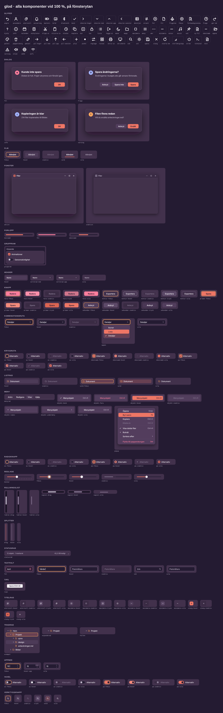

# QzOS design

Presentationen för QzOS skrivbord: temana **Glöd** (mörkt) och
**Gryning** (ljust), komponenterna som SVG i logiska enheter och målet
för hur de ska ersätta NT 4.0 Classic. Börja med [`mal.md`](mal.md), och
[`skal.md`](skal.md) för skalet. `lekplats/index.html` är skalet att prova
i en webbläsare.



## Syfte

Det här repot definierar hur QzOS skrivbord ska se ut och bete sig. Det
är målet för område 1 i generic_gdi #393. NT 3.1 är grunden för
mekaniken: fönster, meddelanden, fokus och kontrollernas funktion
behålls. Det som byts är presentationen.

Repot är ett presentationskontrakt, inte en implementation. Inget här
körs i QzOS. Implementationen hör till libui, libgdi, libsvg och
kompositören.

Delarna används på olika sätt:

| Del | Används som |
|---|---|
| `tokens/tokens.json` | Den auktoritativa källan. libui och skalet ska läsa samma färgroller, mått, typ, skuggor och rörelse, och samma koppling till `COL_*`. |
| `svg/glyfer/`, `svg/appikoner/`, `svg/logo.svg` | Ikoner som kan användas direkt genom libsvg. |
| `svg/glod/`, `svg/gryning/` | Visuella referenser för ritlagret, inte kontroller att ladda. De innehåller exempeltext och skuggfilter, som ligger utanför QzOS SVG-ikonprofil. En riktig kontroll ritar sin geometri, tar texten ur sina egna data genom libtt och får sitt läge från libui. |
| `lekplats/` | En miljö för att snabbt pröva designbeslut, särskilt skalets layout och arbetsflöden. Dess JavaScript är inte början på det riktiga skalet och ska inte flyttas över. |

Ansvaret delas så här:

| Lager | Ansvar |
|---|---|
| QzOS/design | tokens, komponentmått, lägen och visuella referenser |
| libui, ett gemensamt ritlager | kontrollgeometri, text genom libtt, lägen och träffytor |
| libgdi, libsvg och kompositören | banor, täckning, lutningar, alfa, ikoner och fönsterskuggor |

Hover, fokus och andra lägen hör till libui och dess meddelandemodell.
Skuggor och oskärpa hör till fönsterkompositionen. Träffytan för att
ändra ett fönsters storlek är ett kontrakt mellan fönstret och
inmatningen, inte en fråga om grafik.

Nästa steg är ett litet temalager i libui med några få komponenter,
till exempel knapp, textfält, meny och titelrad. Det prövar kedjan
tokens → logiska mått → libui → libgdi och libtt → bildpunkter i båda
temana vid 100, 125, 150 och 200 %. Först när den fungerar flyttas mer
över till den nya presentationen.

## Innehåll

| | |
|---|---|
| `mal.md` | målet: principer, skalning, lägen, komponenterna, krav på mekaniken, öppna frågor |
| `skal.md` | skalets färdriktning: komponenterna, måtten, vad mekaniken behöver |
| `lekplats/` | skalet att använda i en webbläsare; `index.html` byggs ur `mall.html` |
| `tokens/tokens.json` | källan: färgroller för båda temana, mått, radier, typ, skuggor, rörelse och kopplingen till `COL_*` |
| `tokens/glod.css`, `tokens/gryning.css` | rollerna och måtten som CSS-variabler (genererade) |
| `svg/glyfer/` | 59 symboler, 16 u, i `currentColor` |
| `svg/appikoner/`, `svg/logo.svg`, `svg/bakgrund/` | programikoner, QzOS-märket och bakgrundsbilden Dyner |
| `svg/glod/`, `svg/gryning/` | varje komponent i varje läge, en fil per läge; skalets under `skal/` |
| `oversikt/` | kontrollerna och skalet per tema, och ett urval vid 100–200 % (genererade) |
| `docs/dpi.md` | alla mått i bildpunkter vid varje skala (genererad) |
| `verktyg/` | `bygg.py` bygger SVG, CSS, DPI-tabellen och lekplatsen; `oversikt.py` ritar översikterna |
| `tema/` | de första skisserna från Design-ytan, i formatet `.dc.html` |

## Bygga

```sh
python3 verktyg/bygg.py
python3 verktyg/oversikt.py <katalog med manrope-latin-*-normal.woff2>
```

`bygg.py` behöver bara Python. `oversikt.py` behöver Python-paketet
playwright med Chromium. Manrope finns till exempel i npm-paketet
`@fontsource/manrope`.

## Kort om temana

- 1 u = 1 bildpunkt vid 96 dpi. Storlekar avrundas, kanter blir hela
  bildpunkter, se `mal.md`.
- Korall betyder *aktivt eller valt*, bärnsten *titta här*: fokus,
  länkar och varningar. Text på korall och bärnsten är alltid mörk.
- Fel visas alltid med ikon och text, inte bara med färg.
- Typsnitt: Manrope för gränssnittet, JetBrains Mono för terminal och
  kod.
- Radier: 5 u (kryssruta, tips), 8 u (kontroller), 12 u (fönster,
  menyer, dialoger), 22 u (paneler).
