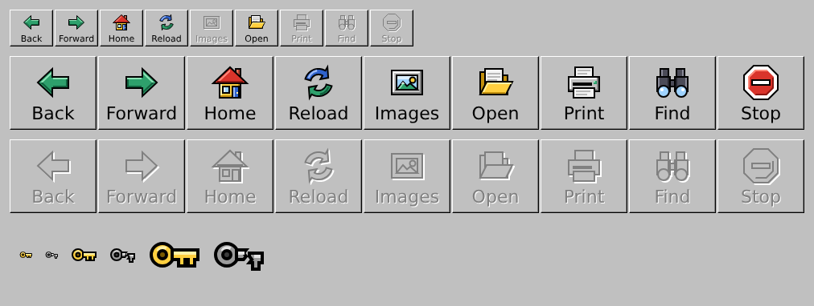

# QzOS design

Målbilden för QzOS skrivbord efter NT 4.0 Classic: temana **Glöd** (mörkt)
och **Gryning** (ljust), gemensamma färgroller och komponentmått, samt
ett nytt skal. NT 3.1-mekaniken för fönster, meddelanden, fokus och
kontroller behålls; presentationen byts.

Läs [målet](mal.md) för designprinciper och regler, [skalets färdriktning](skal.md)
för idéerna om aktivitetsfält och Start-panel, [gaplistan](docs/gaplista.md) för
vad som saknas mot koden i dag, eller prova
[lekplatsen](lekplats/index.html) i en webbläsare.


[Komponenter i Gryning](oversikt/gryning.png) ·
[Skalet i Glöd](oversikt/skal-glod.png) ·
[Skalet i Gryning](oversikt/skal-gryning.png)

## Status och ansvar

Det här är **designkällor och visuella referenser**, inte en implementation
av QzOS skrivbord. `mal.md` beskriver målet för presentationen;
`skal.md` är en utforskande skiss där bland annat fältets form,
Start-panelens innehåll och gruppering av program ännu inte är låsta.
Webblekplatsen simulerar fönster och skalbeteende i HTML, CSS och
JavaScript. Den är inte ett embryo till det riktiga skalet.

Den faktiska implementationen hör till
[QzOS/generic_gdi](https://github.com/QzOS/generic_gdi)
och följer den tekniska riktningen i
[issue #393](https://github.com/QzOS/generic_gdi/issues/393).

| Lager | Ansvar |
|---|---|
| **QzOS/design** | Tema, logiska mått, komponenttillstånd och visuella referenser |
| **libui och skalet** | Kontrollernas geometri och beteende, text via libtt, fokus, hover, träffytor och inmatning |
| **libgdi** | Banor, täckning, gradienter och komposition |
| **libsvg** | Tolkar och ritar ikoner genom GDI, utan en egen rastermotor |
| **Fönsterserver och kompositör** | Fönsterytor, genomskinlighet, skuggor och eventuell bakgrundsoskärpa |

Det är viktigt att skilja mellan två typer av SVG:

- **Ikoner** i `svg/glyfer/`, `svg/appikoner/`, `svg/logo.svg` och
  `svg/webblasare/` kan ritas genom [QzOS SVG Icon Profile](https://github.com/QzOS/generic_gdi/blob/main/docs/svg.md).
- **Komponenter** i `svg/glod/` och `svg/gryning/` är
  designreferenser, inte kompletta kontroller att ladda. De kan innehålla
  exempeltext och SVG-filter utanför ikonprofilen. I QzOS får en kontroll
  sin text och sina tillstånd från libui och ritas av ett gemensamt
  presentationslager.

Tillstånd som *vald*, *hover* och *tangentbordsfokus* behöver kunna
kombineras. Fokusringen och komponentens synliga gräns är inte samma sak
som dess träffyta; exempelvis måste fönstrets osynliga storlekszon
hanteras av inmatningen.

## Prova lekplatsen

`lekplats/index.html` är en genererad, fristående webbsida. Öppna filen
lokalt i en webbläsare, eller kör från repots rot:

```sh
python3 -m http.server 8000
```

Öppna sedan `http://localhost:8000/lekplats/`.

Här kan du öppna och dra fönster, minimera och maximera dem, prova Start
med sökning, programknappar, förhandsvisningar, snabbinställningar och
aviseringar. Reglagen ändrar tema, skala (75–200 %), flytande eller
dockat fält, placering, Start-variant och bakgrund. Terminalens kommandon
är exempelkommandon; fönster, filer, systemstatus och tjänster är
simulerade.

**Lekplatsen använder webbläsarens layout och rendering.** Den visar
designbeslut, inte ett pixeltest av libui, libtt, GDI eller kompositören.
Den använder samma genererade ikoner och tokens som SVG-referenserna,
men resultatet måste senare verifieras på QzOS. Webbsidan fungerar
lokalt; de avsedda webbfonterna hämtas från Google Fonts när nät finns.

## Källor och genererat material

`tokens/tokens.json` är den auktoritativa källan för roller, mått,
radier, typografi, skuggor, rörelse och kopplingen till `COL_*`.
Det betyder att QzOS:s framtida temalager ska **utgå från samma
värden**; det innebär inte att libui måste läsa JSON vid körning.

| Sökväg | Innehåll |
|---|---|
| [`mal.md`](mal.md) | Designprinciper, tillstånd, DPI-regler, komponenter och krav på mekaniken |
| [`skal.md`](skal.md) | Skalets idéer, komponenter, mått och öppna frågor |
| [`tokens/tokens.json`](tokens/tokens.json) | Källvärden för Glöd och Gryning |
| `tokens/glod.css`, `tokens/gryning.css` | Genererade CSS-variabler |
| `svg/glyfer/` | 59 symboler i 16 u, med `currentColor` |
| `svg/appikoner/`, `svg/logo.svg`, `svg/bakgrund/` | Programikoner, QzOS-märket och bakgrunden Dyner |
| `svg/webblasare/` | Ikonerna till [QzOS/browser](https://github.com/QzOS/browser) i 90-talsstil, se nedan |
| `svg/glod/`, `svg/gryning/` | Komponentreferenser i båda teman och deras olika lägen |
| `oversikt/` | Genererade bilder över komponenter, skal och DPI-exempel |
| [`docs/dpi.md`](docs/dpi.md) | Genererade bildpunktsmått vid 100–300 % |
| `lekplats/mall.html` | Handredigerad källa för webblekplatsen |
| `lekplats/index.html` | Genererad webblekplats |
| `verktyg/` | Generatorerna `bygg.py`, `webblasare.py` och `oversikt.py` |
| `tema/` | Tidiga `.dc.html`-skisser, inte auktoritativa |

En logisk enhet, **1 u**, motsvarar en bildpunkt vid 96 DPI.
Målbilden specificerar skalor från **100 till 300 %**. Storlekar
avrundas till bildpunkter, kanter hålls på hela bildpunkter och
glyfstreck kan ligga på halva bildpunkter. De exakta avrundningsreglerna
finns i [`mal.md`](mal.md); tabellerna genereras till
[`docs/dpi.md`](docs/dpi.md).

Korall markerar aktivt eller valt, medan fokus och varning har egna
färgroller som anpassas efter tema och kontrast. Tillstånd visas inte
enbart med färg. Gränssnittet använder Manrope och terminal/kod
JetBrains Mono.

## Webbläsarens ikoner

`svg/webblasare/` har ikonerna till QzOS/browser, som har Netscape
Navigator 3:s uppställning. De har en egen stil, i mitten av 90-talets
anda och inte i Glöd och Gryning: svart kontur, platta färger, en ljus
fasett uppe till vänster och en mörk nere till höger. Inget är ritat
efter Netscape.



| Filer | Storlek | Motsvarar i `src/icons.h` |
|---|---|---|
| `bakat`, `framat`, `hem`, `ladda-om`, `bilder`, `oppna`, `skriv-ut`, `sok`, `stopp` | 24 u | `QBI_BACK` … `QBI_STOP` |
| samma med `-inaktiv` | 24 u | `grey`: avstängd knapp |
| `nyckel-hel`, `nyckel-bruten` | 16 u | `qb_icon_key`: guld och hel när anslutningen är säker, grå och avbruten när den inte är det |

Konturerna ligger på halva enheter och ytorna utan kontur på hela, så att
varje vågrät och lodrät kant är en hel bildpunkt vid 100 och 200 %. Sneda
kanter, bågar och cirklar kantutjämnas.

En avstängd knapp har konturen och de mörkaste ytorna i grått, med samma
sak i vitt en enhet ned och åt höger, som verktygsfälten förr. Formerna
med kontur fylls med `currentColor`, så att de täcker det som ligger bakom
dem precis som i den färgade knappen. Programmet ska därför rita en
avstängd knapp med knappens färg (`COL_BTNFACE`) som
`svg_renderopts.current`; annars blir formerna svarta.

Alla 20 filer tolkas av libsvg i strikt läge. Jämfört med Chromium är
resultatet nästan detsamma vid 200 %. Vid 100 % skiljer sig de sneda
kanterna och bågarna, som mest 96 nivåer av 255 i Ladda om, eftersom de
två kantutjämnar på var sitt sätt.

Throbbern rör sig och ritas i kod (`qb_icon_throbber`), så den finns inte här.

## Bygg om referenserna

Kör från repots rot:

```sh
python3 verktyg/bygg.py
python3 verktyg/oversikt.py <katalog med manrope-latin-*-normal.woff2>
```

`bygg.py` behöver bara Python och genererar SVG, CSS, DPI-tabellen
och `lekplats/index.html` ur `tokens/tokens.json` och
`lekplats/mall.html`. `oversikt.py` använder Playwright med
Chromium samt Manrope-fontfiler för att rita översikterna. Manrope finns
bland annat i npm-paketet `@fontsource/manrope`.

**Redigera källorna, inte genererade SVG-, CSS-, HTML- eller
översiktsfiler för hand.** Nästa test i den verkliga implementationen
är ett begränsat temalager för knapp, textfält, meny och titelrad, i
båda temana vid 100, 125, 150 och 200 %, med verklig textrendering
och tangentbordsnavigering.

## Licens

Apache License 2.0, som QzOS/generic_gdi och QzOS/browser. Se
[`LICENSE`](LICENSE). Det gäller allt i repot: källor, generatorer,
genererade SVG-filer, bilder och dokument.
