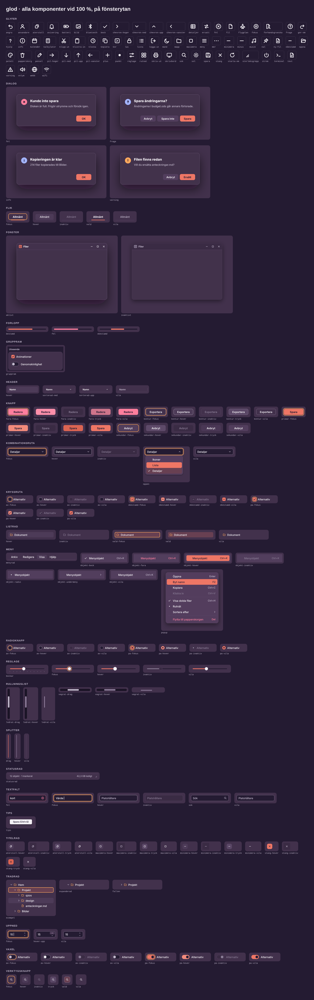
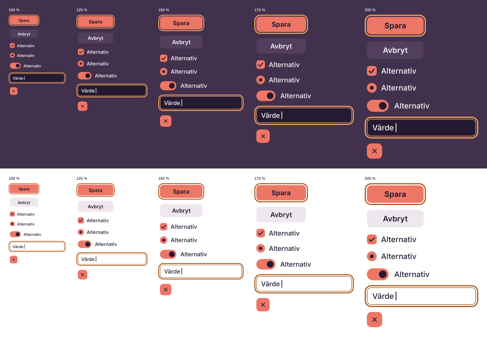

# Målet: QzOS skrivbord efter NT-grunden

Det här dokumentet definierar presentationen som ska ersätta NT 4.0
Classic i QzOS. Det hör till område 1 i generic_gdi #393 (utseende och
kontroller) och tar hänsyn till område 2 (skalning), 3 (alfa) och 4
(renderingstid). Det är ett mål, inte en implementation: generic_gdi
ändras inte här.

## Utgångsläget

NT 3.1 är grunden för mekaniken: fönster, meddelanden, GDI, fokus,
inmatning, resurser och dialoger. NT 4.0 Classic har varit
presentationen: 3D-kanter, 25 systemfärger (`COL_*`), mått i pixlar vid
96 dpi (`MET_*`) och symbolerna i Retro98-typsnittet.

Mekaniken behålls. Presentationen byts.

## Målbilden

Ett mörkt och ett ljust tema, **Glöd** och **Gryning**, med samma
komponenter, mått och regler. Ytorna är platta med rundade hörn. Djup
visas med skuggor i stället för 3D-kanter. Korall (`accent`) betyder
*aktivt eller valt*. Bärnsten (`fokus`, `varning`) betyder *titta här*.
Allt mäts i logiska enheter och ritas skarpt i alla skalor från 100 till
300 %.

Komponenterna finns som SVG i `svg/`, i varje läge och i båda temana.
Översikterna i `oversikt/` visar alla på en gång.



## Principer

1. **Roller, inte färger.** En komponent ritas bara med färgrollerna i
   `tokens/tokens.json`. Ett nytt tema är en ny uppsättning roller,
   inte nya komponenter.
2. **Logiska enheter.** Alla mått är i u. Ingen komponent känner till
   bildpunkter, bara skalan när den ritas.
3. **Samma lager ritar allt.** Ram, menyer, kontroller och dialoger
   ritas av samma funktioner per komponent och läge. Det som i dag är
   `ui_drawframectl` och `ui_drawedge` blir det lagret.
4. **Tillgängligt som standard.** Text har minst 4,5:1 i kontrast mot
   sin bakgrund. Kanten som visar en kontroll (fält, kryssruta,
   radioknapp, växel) har minst 3:1 mot fönsterytan. Ett läge visas
   aldrig bara med färg: valt har bock eller punkt, fel har ikon. I
   Gryning har korallen bara 2,8:1 mot vitt, så där bärs läget av det
   mörka märket ovanpå (5,9:1), inte av fyllningen.
5. **Text på korall och bärnsten är mörk** (`pa-accent`). Ljus text på
   korall klarar inte kontrastkraven.
6. **Mekaniken bestämmer, presentationen följer.** Träffytor,
   meddelanden och tangentbord är desamma som i dag. Ett nytt utseende
   får inte ändra beteendet.

## Logiska enheter och skalning

1 u är 1 bildpunkt vid 96 dpi. Skalan *s* är per skärm: 1, 1,25, 1,5,
1,75, 2, 2,5 eller 3.

| Vad | Regel | Exempel vid 150 % |
|---|---|---|
| Storlekar, utfyllnad, avstånd, radier | `round(u × s)`, halvor uppåt | kontrollhöjd 32 u → 48 |
| Kanter och avskiljare | `max(1, floor(u × s))` | kant 1 u → 1, fokusring 2 u → 3 |
| Glyfernas streck | `round(1,5 × s × 2) / 2`, kantutjämnat | 1,5 u → 2,5 |
| Text | `round(u × s)` bildpunkter, hintad av libtt | brödtext 14 u → 21 |
| Mått centrerade i ett annat | som storlekar, och 1 bildpunkt till om pariteten skiljer sig från det yttre måttets | reglagets spår 4 u i knappen 18 u → 6 blir 7, i 27 |

Kanter ligger på hela bildpunkter, så en 1 u-kant är skarp i alla
skalor. En kant med udda bredd ritas med mitten på en halv bildpunkt.
Alla mått i bildpunkter för varje skala står i `docs/dpi.md`, som
genereras ur tokens.

En SVG här har sin `viewBox` i u. Samma fil ritas i en annan skala
genom att bredd och höjd multipliceras med *s*. `oversikt/dpi.png`
visar ett urval vid 100–200 %.



## Lägena

| Läge | När | Hur det syns |
|---|---|---|
| vila | inget händer | grundutseendet |
| hover | muspekaren är över | `yta-hover`, `knapp-hover` eller `accent-hover` |
| tryck | musknappen är nere över kontrollen | `yta-tryck`, `knapp-tryck` eller `accent-tryck` |
| fokus | kontrollen har tangentbordsfokus och fokus kom från tangentbordet | ring 2 u bred, 2 u utanför kanten, i `fokus` |
| inaktiv | kontrollen är avstängd | `yta-inaktiv` och `text-inaktiv` |
| vald | posten är markerad | `markering` och `markering-text`, i menyer `accent` |
| fel | värdet är ogiltigt | kant i `fel` och felikonen |
| öppen | listan eller menyn är uppfälld | som fokus, med popupen i höjd 1 eller 2 |

I listor, träd och flikar ligger fokusringen **innanför** raden, eftersom
grannarna ligger kant i kant. Fokusringen visas när fokus kom från
tangentbordet. Efter ett musklick visas den inte.

## Höjder och skuggor

| Höjd | Används för | Skugga (y, oskärpa) |
|---|---|---|
| 1 | tips, uppfällda listor | 2 u, 6 u |
| 2 | menyer, popuper, inaktiva fönster | 8 u, 24 u |
| 3 | aktivt fönster, dialoger | 24 u, 56 u |

Skuggans färg och styrka står per tema i `tokens.json`.

## Komponenterna

| Komponent | Filer | Ersätter i libui i dag | Lägen |
|---|---|---|---|
| Fönster | `fonster/` | ramen i `defproc.c` | aktivt, inaktivt |
| Titelradsknappar | `titelrad/` | `ui__captionbutton`, `DFC_CAPTION` | minimera, maximera, återställ, stäng × vila, hover, tryck, inaktiv |
| Menyrad, popupmeny, menyobjekt | `meny/` | `menu.c`, `DFC_MENU` | vila, hover, bock, radio, undermeny, inaktiv, fara |
| Knapp | `knapp/` | `CTL_BUTTON` | primär, sekundär, kontur, fara × alla fem lägen |
| Kryssruta | `kryssruta/` | `CTL_BUTTON` med kryssrutestil, `DFCS_BUTTONCHECK` | av, på, obestämd × vila, hover, fokus, inaktiv |
| Radioknapp | `radioknapp/` | `CTL_BUTTON` med radiostil | av, på × vila, hover, fokus, inaktiv |
| Växel | `vaxel/` | ny | av, på × vila, hover, fokus, inaktiv |
| Textfält, sökfält | `textfalt/` | `CTL_EDIT` | vila, hover, fokus, fel, inaktiv |
| Kombinationsruta | `kombinationsruta/` | `CTL_COMBO` | vila, hover, fokus, inaktiv, öppen |
| Upp/ned | `uppned/` | `CTL_UPDOWN` | vila, fokus, hover på uppåt |
| Rullningslist | `rullningslist/` | `CTL_SBAR`, ramens listor | lodrät, vågrät × vila, hover, drag |
| Listrad | `listrad/` | `CTL_LIST`, `CTL_LISTVIEW` | vila, hover, vald, vald med fokus, inaktiv |
| Trädrad | `tradrad/` | `CTL_TREE` | fallen, expanderad, exempel |
| Header | `header/` | `CTL_HEADER` | vila, hover, sorterad uppåt och nedåt |
| Flik | `flik/` | `CTL_TAB` | vald, vila, hover, fokus, inaktiv |
| Skjutreglage | `reglage/` | `CTL_TRACKBAR` | vila, hover, fokus, inaktiv, med bockar |
| Förlopp | `forlopp/` | `CTL_PROGRESS` | bestämd, obestämd, fel |
| Verktygsknapp | `verktygsknapp/` | knapparna i `CTL_TOOLBAR` | vila, hover, tryck, vald, fokus, inaktiv |
| Tips | `tips/` | `CTL_TOOLTIP` | |
| Statusrad | `statusrad/` | `CTL_STATUS` | |
| Gruppram | `gruppram/` | gruppramen i `CTL_BUTTON` | |
| Splitter | `splitter/` | `CTL_SPLITTER` | vila, hover, drag |
| Dialog | `dialog/` | `ui_msgbox` och standardikonerna | info, varning, fel, fråga |

Varje komponent finns i `svg/glod/` och `svg/gryning/`. Filen har 4 u
marginal runt komponenten, så att fokusringen ryms. Fönster, menyer och
dialoger har större marginal för skuggan.

Rullningslisten är smal i vila (4 u tumme) och breddas till 8 u med ett
spår vid hover. Pilknapparna försvinner. Rullning sker med hjul, tumme,
klick i spåret och tangentbord.

Fönstret ändrar storlek med en osynlig zon 6 u utanför kanten och 12 u
i hörnen. Storleksgreppet i statusraden är valfritt.

## Glyferna

`svg/glyfer/` har 71 symboler på ett rutnät om 16 u: 12 u levande yta,
streck 1,5 u med runda ändar, ritade i `currentColor`. 28 av dem är för
kontrollerna och ersätter Retro98-typsnittets 27 tecken (`U+E100`–`U+E11A`) och kan byggas till
ett typsnitt på samma sätt som Retro98 byggs med `build.py`. Då hintar
libtt dem i varje storlek, som all annan text.

Verktygsfältets knappar har glyfer i stället för NT:s bilder. comctl32:s
standardbilder (`STD_*`, `ui_stdtbimages` i generic_gdi) och File
Managers knappar får de här:

| Bild | Glyf |
|---|---|
| `STD_CUT` | `klipp-ut` |
| `STD_COPY` | `kopiera` |
| `STD_PASTE` | `klistra-in` |
| `STD_UNDO` | `angra` |
| `STD_REDOW` | `gor-om` |
| `STD_DELETE` | `papperskorg` |
| `STD_FILENEW` | `ny-fil` |
| `STD_FILEOPEN` | `oppna` |
| `STD_FILESAVE` | `spara` |
| `STD_PRINTPRE` | `forhandsgranska` |
| `STD_PROPERTIES` | `reglage` |
| `STD_HELP` | `hjalp` |
| `STD_FIND` | `sok` |
| `STD_REPLACE` | `ersatt` |
| `STD_PRINT` | `skriv-ut` |
| Upp en nivå | `pil-upp` |
| Stora ikoner | `rutnat` |
| Lista | `lista` |
| Detaljer | `detaljer` |
| Uppdatera | `starta-om` |

Signalikonerna i dialogerna (info, varning, fel, fråga) är en fylld
cirkel i signalfärgen med märket i `pa-`-färgen ovanpå.

## Bakåtkompatibilitet

Program som bara känner `COL_*` ska se rätt ut. `tokens.json` har under
`systemfarger` den roll varje systemfärg får sitt värde från. Ett
program som ritar egna kontroller med `ui_drawframectl` får det nya
utseendet automatiskt, eftersom funktionen ritas av samma lager som
libuis egna kontroller.

`COL_BTNFACE` är dialogens och 3D-ytans färg, alltså `yta`: dialoger,
egenskapssidor, gruppramar, verktygsfält och statusrader. I NT är den
också tryckknappens fyllning, men designen ger knappen `knapp`. Därför
har `tokens.json` ett avsnitt `profilfarger` med färger som profilerna
har utöver systemfärgerna: knappens fyllning i vila, hover och tryck,
och en avstängd kontrolls fyllning (`yta-inaktiv`). I Classic har de
samma värden som `COL_BTNFACE`.

Verktygsknappen har ingen fyllning i vila. Vid hover och tryck får den
`yta-hover` och `yta-tryck`. Vald får den `markering`, en ram på 1 u i
`kant-kontroll` och glyf och text i `markering-text`. Fyllningen har för
lite kontrast mot ytan (1,38:1 i Glöd, 1,17:1 i Gryning) för att bära
läget ensam, så ramen visar det (princip 4); den har 3,14:1 och 3,7:1.
Glyf och text delar färg, och `markering-text` klarar 4,5:1 mot
`markering` i båda temana. Ingen av färgerna är en systemfärg, så de
står i `profilfarger` (`toolbar.fill.*`, `toolbar.text.checked`,
`toolbar.frame.checked`). I Classic ritas verktygsknappen med NT:s
kanter och har inga egna färger.

## Krav på mekaniken

Det här behöver finnas i generic_gdi innan målet kan nås. Ordningen
följer beroendena i #393. Där en punkt redan finns i main står det vid
punkten; skalets punkter står i `skal.md`.

1. **Logiska koordinater och skala per skärm.** libui räknar i u, och
   ett meddelande motsvarande `WM_DPICHANGED` ritar om när skalan byts.
   Måste komma före ritlagret, annars skrivs alla kontroller om två
   gånger.
2. **Ett gemensamt ritlager** med en funktion per komponent och läge,
   som tar roller och skala. Ersätter ritningen i `framectl.c`,
   `defproc.c`, `menu.c` och `ctl/`.
3. **Hover.** Kontrollerna behöver få veta när muspekaren lämnar dem,
   motsvarande `WM_MOUSELEAVE`. NT 3.1 har inget hoverläge. Finns i
   main: `MSG_MOUSELEAVE`, som NT 4.0:s `TrackMouseEvent`.
4. **Fokus från tangentbordet.** Ett sätt att veta om fokus kom från
   tangentbordet, motsvarande `WM_UPDATEUISTATE`.
5. **TrueType i gränssnittet.** Manrope och JetBrains Mono via libtt,
   registrerade med `gdi_addfont`, i stället för de inbyggda
   bitmappsfonterna.
6. **Alfa hela vägen** (område 3). Skuggor, rundade fönsterhörn och
   genomskinliga popuper kräver förmultiplicerad alfa från libgdi till
   kompositören. Finns i main (#450): konstant alfa per fönster,
   `WNDX_LAYERED`, skuggor som servern ritar och hörn som servern skär
   till en radie. Oskärpa bakom ytor ingår inte i målet.
7. **Animering i takt med skärmen** (område 4). Övergångar mellan lägen
   tar `rorelse.kort` (120 ms), popuper `rorelse.medel` (200 ms), och
   följer `WS_FRAME` i stället för timers. `WS_FRAME` med verklig
   presentationstid finns i main (#435); övergångarna använder den inte
   än.

## Utanför det här

- **Skalet** har ett eget dokument, `skal.md`, med färdriktningen:
  ett flytande aktivitetsfält och en Start-panel, och lekplatsen.
- Filtypsikoner utöver mapp och fil.
- Markörer.

## Öppna frågor

1. Behövs ett tema med hög kontrast utöver Glöd och Gryning?
2. Behövs en tätare variant (kontrollhöjd 28 u) för listor och
   verktyg, eller en glesare (40 u) för pekskärm?
3. Ska accentfärgen kunna väljas av användaren? Rollerna tillåter det,
   men kontrasten måste då kontrolleras för varje val.

## Bygga om

```sh
python3 verktyg/bygg.py                  # svg/, tokens/*.css, docs/dpi.md, lekplats/index.html
python3 verktyg/oversikt.py <typsnitt>   # oversikt/*.png, kräver playwright
```

`tokens/tokens.json` är källan. Ändra där och bygg om, ändra inte de
genererade filerna för hand.
