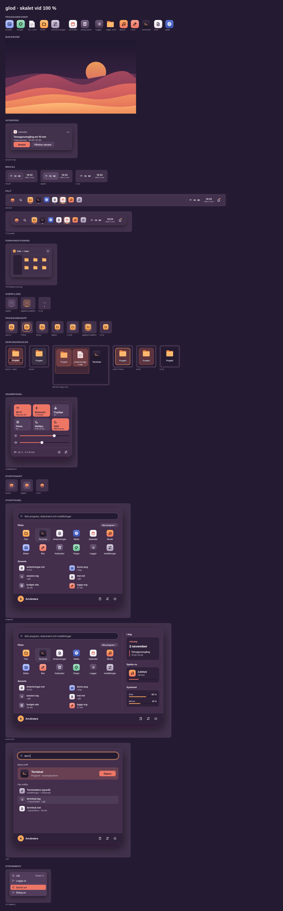

# Skalet: färdriktning

Det här dokumentet är riktningen för hur skalet ska se ut och kännas.
Formen går mot ett modernt skrivbord med ett flytande fält och en
Start-panel. Den ska vara QzOS egen, inte en kopia av något annat system.
Det är brainstorming: komponenterna finns för att prova, och lekplatsen
för att se dem tillsammans.

Skalet i generic_gdi (`examples/shell/`) är i dag Shell95-skissen,
ritad efter designprofilen (generic_gdi #481): ett dockat fält med en
textknapp per fönster och accentmarkören under den aktiva, en Start-meny
med accentbanderoll och solen, skrivbordsikoner ur `~/Desktop` och
klockan. Lekplatsen visar båda: läget **I dag** är det skalet, läget
**Mål** är målbilden. Avsnittet [Vad mekaniken behöver](#vad-mekaniken-behöver)
säger vad som finns i generic_gdi main och vad som saknas.

## Referensen

Målet ska gå att nå med mekanik som finns eller kan byggas utan att
stilen går förlorad. Därför gäller tre saker för bilderna i `oversikt/`,
SVG-filerna och lekplatsens standardläge:

- **Oskärpa är ett val, inte målet.** Utan oskärpa är fältet
  halvgenomskinligt (`yta` 92 % flytande, 94 % dockat) och panelerna
  täckande, eftersom texten i fönstren bakom en panel annars skymtar
  igenom. Oskärpa bakom dem får läggas till där kompositören klarar
  det, och då får panelerna vara 96 %, men inget får hänga på den. I
  lekplatsen är den ett reglage som är av från början.
- **Brickan visar bara verklig status.** En statussymbol ritas bara när
  en tjänst har något att visa: Wi-Fi när det finns ett trådlöst nät,
  batteriet när det finns ett batteri. Finns ingen symbol visar knappen
  till snabbinställningarna glyfen `reglage`. Referensbilden har
  brickan med klockan och aviseringarna och inga symboler, eftersom
  ingen tjänst rapporterar något än. `bricka/alla-symboler` och
  lekplatsens reglage *Alla* visar hur det blir med wifi, volym och
  batteri.
- **Texten går att läsa utan oskärpa**, också över Dyner. Sämsta fallet
  är den ljusaste delen av bilden bakom ytan:

  | Yta utan oskärpa | Text | Glöd | Gryning | Grafit |
  |---|---|---|---|---|
  | Fältet, `yta` 92 % | `text` | 8,78:1 | 15,39:1 | 10,89:1 |
  | | `text-dampad` | 5,20:1 | 5,86:1 | 6,45:1 |
  | Paneler, täckande `yta` | `text-dampad` | 6,21:1 | 6,25:1 | 7,54:1 |
  | Låsskärmen, `bakgrund` 75 % | `text-dampad` | 4,70:1 | 4,65:1 | 5,37:1 |
  | Skrivbordsikonens etikett, direkt på bilden | `text` | 4,54:1 | 7,31:1 | 8,55:1 |

  Låsskärmens slöja är 75 % utan oskärpa och 35 % med. Etiketterna
  ligger över himlen och de två översta dynerna, och den sämsta av dem
  ger siffran ovan; skuggan bakom texten är en marginal, inte det som
  bär kontrasten.

## Lekplatsen

`lekplats/index.html` är skalet att använda i en webbläsare: fönster som
öppnas, aktiveras, minimeras, maximeras och dras, och skrivbordsikoner.
Reglaget **Skalet** växlar mellan två lägen med samma tokens och
komponenter, i Glöd, Gryning och Grafit:

- **Mål** är målbilden: det flytande eller dockade fältet med
  programknappar, Start-panelen med sök och alla program,
  snabbinställningarna, aviseringarna, förhandsvisningen av fönster
  och strömmenyn med låsskärm. Reglagen byter fältets form och
  placering, Start-panelens variant, brickans symboler (*Med källa*
  eller *Alla*) och oskärpan (av eller på).
- **I dag** är skalet i generic_gdi main: ett dockat fält 40 u högt med
  Start, en textknapp per fönster utan programikon och bara klockan i
  brickan. Start är en meny med accentbanderoll: Program, Dokument,
  Inställningar, Hjälp, Kör och Avsluta. Program visar bara programmen
  som finns i `generic_gdi/examples`; Inställningar har Aktivitetsfältet
  och profilerna, där Classic och Flat är gråa eftersom de inte finns i
  designen. Ingen sök, inga snabbinställningar, aviseringar eller
  förhandsvisning.

Tema, skala (75–200 %) och bakgrund gäller båda. Terminalen förstår
`hjälp`, `ls`, `tema`, `skala` och `öppna`.

Sidan byggs av `verktyg/bygg.py` ur `lekplats/mall.html`. Färgerna och
måtten kommer ur `tokens/tokens.json`, och glyferna, programikonerna och
bakgrunden ur samma kod som SVG-filerna. Ändras en token ändras
lekplatsen med den.

## Komponenterna

Filerna ligger under `svg/<tema>/skal/`.

| Komponent | Filer | Lägen | Finns i skalet i dag |
|---|---|---|---|
| Aktivitetsfältet | `falt/` | flytande, dockat | dockat längs en valfri kant, platt på `COL_WINDOW` med profilen (`i-dag/falt`) |
| Programknapp | `programknapp/` | vila, hover, tryck, öppen, aktiv, uppmärksamhet, fokus | en textknapp per fönster, accentmarkören under den aktiva; ingen ikon, ingen uppmärksamhet |
| Fler program | `overflode/` | vila, öppen, uppmärksamhet | två pilknappar som rullar raderna |
| Start-knapp | `startknapp/` | vila, hover, öppen | solen och texten Start, nedtryckt när menyn är uppe |
| Bricka och klocka | `bricka/` | vila, hover, öppen, alla symboler | bara klockan, HH:MM eller med sekunder |
| Start-panelen | `startpanel/` | kompakt, med översikt, sök | en ägarritad meny med accentbanderoll och solen (`i-dag/startmeny`) |
| Strömmenyn | `strommeny/` | | Avsluta, som dialog |
| Snabbpanelen | `snabbpanel/` | | nej |
| Avisering | `avisering/` | | nej |
| Förhandsvisning | `forhandsvisning/` | | nej |
| Skrivbordsikon | `skrivbordsikon/` | vila, hover, vald, vald med fokus, byter namn, markeringsruta | `desktop.c`, utom markeringsrutan, i ett rutnät om 75 × 70 bildpunkter |
| Skalet i dag | `i-dag/` | fältet, Start-menyn | det generic_gdi main ritar med profilen, som referens för lekplatsens läge I dag |

Dessutom, gemensamt för alla teman:

- `svg/appikoner/`: tolv programikoner för programmen i
  `generic_gdi/examples` och några som skalet behöver plats för, samt
  stora mapp- och filikoner för skrivbordet.
- `svg/logo.svg`: QzOS-märket, en sol vid horisonten.
- `svg/bakgrund/`: bakgrundsbilden Dyner i alla teman. I Grafit är himlen och de bortre
  dynerna grafit, och solen och de närmaste dynerna korall.
- `svg/glyfer/`: 71 glyfer, bland dem de skalet använder: ström, wifi,
  volym, batteri, lås, avisering, reglage och andra.

## Mått

| Mått | u |
|---|---|
| Fältets höjd | 56 |
| Fältets avstånd från kanten, flytande | 8 |
| Knappcell i fältet | 44, ikonen 32 |
| Markören under en knapp | 6 × 3 öppen, 16 × 3 aktiv |
| Brickans knapp | 20 + 24 per symbol; utan symboler en knappcell, 44 |
| Start-panelen | 640 bred, 880 med översikt |
| Snabbpanelen och aviseringarna | 360 breda |
| Skrivbordsikon | cell 88 × 100, ikon 48, etikett högst två rader |
| Programikon | 48, hörnradie 27 % |
| Fältet i dag | 40 hög: knapphöjden `kontroll-h` 32 och 4 på var sida; uppgiftsknappar högst 160 breda |
| Start-menyn i dag | banderollen 28, objekten `menyobjekt-h` 30 |

Arbetsytan (`ui_setworkarea`) är skärmen utom fältet och dess avstånd:
72 u nedtill för det flytande fältet, 56 u för det dockade och 40 u för
fältet i dag.

## Beteende i gränsfallen

Det här är beteendekontrakt för skalet och libui, inte bara för
lekplatsen. Lekplatsen gör så här, och det går att pröva där.

### Smal skärm och hög skala

Allt räknas i u, så en hög skala gör skärmen smalare i u. Vid 200 % är
en skärm om 1920 bildpunkter 960 u bred.

- **Start-panelen** är 640 u bred, men aldrig bredare än skärmen minus
  8 u på var sida. Rutnätet med fästa program tar så många kolumner om
  minst 92 u som ryms, och listan Senaste så många om minst 240 u.
- **Översikten** i Start visas bara när panelen ryms med den, alltså när
  skärmen är minst 896 u bred. Annars visas den kompakta panelen, även
  om översikten är vald.
- **Fönster** öppnas och hålls inom arbetsytan: ett fönster blir aldrig
  större än arbetsytan minus 16 u, och minst 120 u av titelraden går
  alltid att nå. Fönstret minns sin egen storlek och får tillbaka den
  när det finns plats.
- **Ett maximerat fönster** följer arbetsytan när fältet byter form
  eller skalan ändras.

### Överflöd i fältet

- Programknappar som inte ryms samlas bakom en **Mer-knapp** sist i
  gruppen, med glyfen `mer`. Den öppnar en meny med programmen och om
  de är öppna eller minimerade.
- **Det aktiva programmets knapp syns alltid.** Ligger den bland de
  dolda byter den plats med den sista synliga.
- Mer-knappen har markören för öppen om något dolt program har fönster,
  och uppmärksamhetens markör om något av dem ber om uppmärksamhet.
- Hur många knappar som ryms räknas om när fönster öppnas och stängs,
  när skärmen ändrar storlek och när skalan eller fältets form byts.

### Fokusets livscykel

1. **Panel eller meny öppnas** (Start, snabbinställningarna,
   aviseringarna, strömmenyn, Mer): skalet minns var fokus var, och
   fokus flyttas in i panelen. Start får fokus i sökfältet, så att det
   går att skriva direkt. De andra får fokus på sin första knapp.
2. **Escape, eller samma knapp igen,** stänger och lämnar tillbaka fokus
   dit det var. En meny lämnar tillbaka fokus till knappen som öppnade
   den.
3. **Något väljs i panelen:** det som öppnas får fokus, inte det som
   hade fokus före.
4. **Ett klick utanför** stänger panelen, och fokus stannar där klicket
   hamnade.
5. **Ett fönster som aktiveras** får fokus där det var senast i
   fönstret, annars i första fältet, annars i fönstret självt.
6. **Ett aktivt fönster som minimeras eller stängs** lämnar fokus till
   nästa fönster i z-ordningen. Finns inget får skrivbordet fokus.
7. **Låsskärmen** minns fokus på samma sätt och lämnar tillbaka det när
   den låses upp.

Tangenter:

- **Ctrl+Esc** öppnar och stänger Start, som i NT. **Super** ensam gör
  samma sak. I läget I dag öppnar de Start-menyn.
- **Pil upp och ned, Home och End** flyttar mellan objekten i en meny.
  **Pil höger** öppnar en undermeny och **pil vänster** stänger den.

I generic_gdi behöver punkt 1 och 2 regeln för att skalet får ta fokus
(F3 i `docs/shell.md`), och punkt 5 att libui minns fokus per fönster
när det inaktiveras.

## Vad mekaniken behöver

Läget mot generic_gdi main (d2938db). Det som är klart behöver inget
mer för målbilden; det som saknas byggs inte nu.

**Klart i main:**

| Mekanik | Var |
|---|---|
| Alfa och skuggor: konstant alfa per fönster, `WNDX_LAYERED`, skuggor som servern ritar (`WS_SYS_SHADOW`) | generic_gdi #450, stängd |
| Rundade hörn: servern skär toppfönstrens hörn till en radie och ritar kantlinjen längs dem | `include/ws/proto.h`, temalagret #460 |
| Profilerna Glöd och Gryning, genererade ur `tokens/tokens.json` (`systemfarger` och `profilfarger`) | `tools/gen-profiles.py`, `profiles/` |
| Kontrollerna ritade efter profilen | `src/ui/theme.c`, #460 |
| Skalet efter profilen: platt fält på `COL_WINDOW`, accentmarkör under den aktiva uppgiften, accentbanderoll och solen i Start, menyrader minst `MET_MENUITEM_H` | #481 |
| Knapphöjden ur profilen (`MET_CTL_H`), så att fältet blir 40 u | `examples/shell/draw.c` |
| Ikonrutnätets cell som profilnycklar, `icon.spacing.width` och `.height` | #479 |
| Hover: `MSG_MOUSELEAVE` | `include/gdi/ui.h` |
| Bildrutor med verklig presentationstid, `WS_FRAME` | #435, stängd |

**Delvis:**

- **Skalning.** Profilernas mått är nominella vid 96 dpi och skalas
  med skärmen, men pixelkontraktet och DPI per fönster är kvar (#439,
  öppen).
- **Skrivbordets rutnät.** Nycklarna finns (#479), men `desktop.c` har
  kvar `CELL_W` 75 och `CELL_H` 70 bildpunkter i stället för cellen
  88 × 100 u.
- **Animering.** `WS_FRAME` finns, men panelerna glider inte in på
  `rorelse.medel` (200 ms); skalet har inga övergångar än.

**Saknas:**

1. **Fönsterikoner i skalprotokollet.** Programknapparna visar ikoner,
   och protokollet bär inga i dag (`docs/shell.md`). Knappar för fästa
   program behöver också en lista i skalets inställningar, bredvid
   genvägarna under `shell/programs`.
2. **Uppmärksamhet.** Ett program ska kunna be om uppmärksamhet,
   motsvarande `FlashWindow`. Knappen får då en bärnstensfärgad markör.
3. **Miniatyrer.** Förhandsvisningen behöver fönstrets bild från
   servern, som redan håller den (`gfx_image_share_desc`).
4. **Start som panel.** Start-panelen är ett eget popupfönster med sök,
   rutnät och listor, inte en ägarritad meny. Tangentbordet behöver
   regeln för att skalet får ta fokus (F3 i `docs/shell.md`).
5. **Sök.** En källa som söker i program, senaste dokument och
   inställningar, gärna genom libshells namnrymd.
6. **Meddelandefältet.** Snabbpanelen och aviseringarna kräver det lilla
   protokoll som är uppskjutet tills en klient behöver det, och tjänster
   för nätverk, ljud och ström som rutorna kan styra och som ger brickan
   dess symboler.
7. **Oskärpa** bakom fältet och panelerna. Ingår inte i målet:
   referensen är genomskinlig utan oskärpa eller täckande. Kompositören
   har bara skuggornas oskärpa, och det räcker.

## Öppna frågor

1. Ska fältet vara flytande eller dockat som standard?
2. Centrerat eller vänsterställt?
3. Ska Start-panelen ha översikten, och vad hör hemma i den?
4. Ska fästa program och öppna fönster dela knapp, som här, eller
   ligga i var sin grupp?
5. Behövs virtuella ikoner på skrivbordet, som Papperskorgen?
